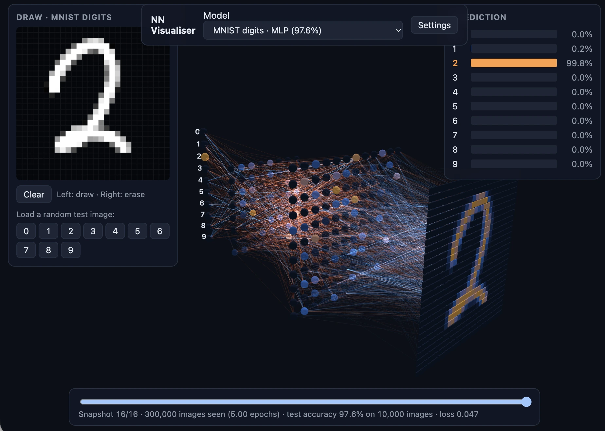
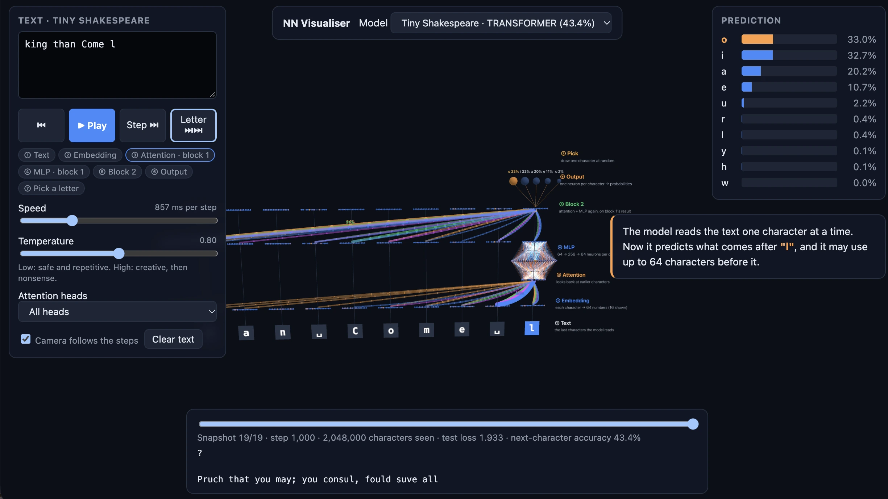

# Neural Networks for Kids

Train a small neural network in **pure TypeScript** (no Python, no ML libraries) and watch it
classify your drawings in 3D.

**How it works, explained step by step:** [read the guide](https://purchart.eu/list?file=2026-11-11--06-53-52---vasek---nn-how-it-works.html)
(source in [`docs/how-it-works.html`](docs/how-it-works.html)).



## Quick start

You need [Node.js](https://nodejs.org) 20 or newer (`.nvmrc` pins 24, so `nvm use` picks it). Nothing else: no Python, no GPU.

The repository contains only code. Datasets download automatically the first time you train
(cached in `data/`), and the viewer shows the models you have trained (saved to `public/models/`),
so train at least one model before running `npm run dev`.

```bash
npm install
npm run train -- --dataset mnist             # digits, ~1–2 min
npm run train -- --dataset emnist-letters    # letters A–Z (one-time ~560 MB download)
npm run train -- --dataset mnist --arch cnn            # convolutional version
npm run train -- --dataset emnist-letters --arch cnn
npm run dev                                   # open the printed URL
```

Draw with the left mouse button, erase with the right. Drag the 3D view to orbit, right-drag to pan,
zoom with the mouse wheel or a pinch; on a touchpad, swipe with two fingers to pan. Click a neuron to see how its value is computed. Use the slider at the bottom to
replay training from random weights to the final model.

### Single-file version

`npm run build:standalone` writes `dist/nn-vis-standalone.html` (~30 MB with the four image models and two text models): the app, three.js, the styles
and every trained model with all its snapshots in one file. Double-click it to open it from disk;
it needs no server and no network, so it can be emailed or copied anywhere.

## Training options

```
npm run train -- --dataset <mnist|emnist-letters>
  --arch mlp               mlp (dense layers) or cnn (convolutional)
  --hidden 128,64          dense hidden layer sizes (cnn default: 64)
  --filters 8,16           cnn only: filters per conv+pool block
  --epochs 5               passes over the training set (cnn default: 3)
  --batch 64               mini-batch size
  --lr 0.001               Adam learning rate
  --seed 42                random seed
  --limit N                use only the first N images (quick experiments)
  --samples-per-class 100  test images available via the sample buttons
  --offline                don't download; explain what's missing
  --clean-downloads        delete the EMNIST zip after extraction
```

Datasets are cached in `data/`; trained models go to `public/models/` (both git-ignored).

## How it works

| Folder | What it does |
|---|---|
| `src/nn/` | The whole network in plain TypeScript: a `Network` of dense, 3×3 conv and 2×2 max-pool layers, ReLU, softmax, cross-entropy, backprop, Adam, float16 weight files. Shared by trainer and browser. |
| `src/data/` | Downloads and parses the MNIST / EMNIST IDX files (EMNIST needs a transpose and a label shift). |
| `src/trainer/` | CLI training loop; saves weight snapshots (dense early on, then one per epoch) for the timeline. |
| `src/web/` | Vite + Three.js viewer: sketchpad, probability chart, 3D network, timeline, neuron inspector. |

Things worth knowing:

- Your drawing is first scaled so its ink fits the dataset's character size (20 px for digits,
  24 px for letters), as the datasets were prepared. Turn this off in Settings to compare.

- It is then centred the way the dataset was: digits by centre of mass (as MNIST was prepared),
  letters by their bounding box (as EMNIST was). On the stored test images this choice is worth
  about 8 points for the letters MLP and 3 for the letters CNN. The 3D input layer shows the
  processed image.
- Connection colours show *input × weight* — what each connection actually contributes for your
  current drawing — not just the weight. Warm = pushes the neuron up, cool = pushes it down.
- Inputs are normalised with the training set's mean/std, so blank pixels are slightly negative and
  do contribute.
- EMNIST "letters" mixes upper- and lower-case under one label (e.g. "A" = A or a).

## MLP vs CNN

Both architectures train with the same code and live side by side in the model picker.

| | MLP (default) | CNN (`--arch cnn`) |
|---|---|---|
| Layers | dense 128 → dense 64 → output | conv 8 → pool → conv 16 → pool → dense 64 → output |
| Weights | ~109 k | ~28 k |
| Digits accuracy | 97.6 % (5 epochs) | 98.1 % (3 epochs) |
| Letters accuracy | 87.9 % (3 epochs) | 91.3 % (3 epochs) |
| Training time per epoch (digits, laptop CPU) | ~15 s | ~40 s |

In the 3D view a CNN's convolutional layers appear as grids of small images — one per filter,
lit where that filter's pattern appears in your drawing. Click one to see its 3×3 weights (one
small grid per input channel). Max-pool layers aren't drawn separately, and there are no lines
between feature maps to keep the view readable. The defaults are deliberately small so training
stays quick; `--filters 32,64 --hidden 128 --epochs 5` gives a bigger, more accurate (and slower) CNN.

Model files from before the CNN option (format v1) still load; MLP models keep their folder names
(`public/models/mnist/`), CNNs are stored as `public/models/<dataset>-cnn/`.

## Text: a tiny transformer

The same trainer can also learn to write text, one character at a time, with the architecture behind
real LLMs: a GPT-style transformer (character and position embeddings, causal multi-head
self-attention, MLP blocks, LayerNorm, residual connections), forward and backward passes written by hand.

```bash
npm run train -- --dataset shakespeare            # Tiny Shakespeare, ~16 min on an M-series Mac
npm run train -- --dataset names                  # invents new first names
npm run train -- --dataset text --file book.txt   # any UTF-8 text, e.g. a Czech book
```

Options: `--context 64 --d-model 64 --heads 4 --blocks 2 --steps 1000 --batch 32 --lr 0.003`
(about 113k weights). The last 10% of the text is the test set; the timeline label shows test loss and
how often the most likely next character was right.

In the viewer, pick a text model and type a start (e.g. `ROMEO:`). The 3D view shows the network as
a labeled diagram, bottom to top: ① your text, ② each character's neurons (embedding), ③ attention arcs
(one color per head) into the selected character, ④ its MLP, ⑤ block 2, ⑥ the output neurons and ⑦ the
picked character. A player walks through these steps: **Step** / **Back** one at a time, **Play** to
run them automatically (at high speed it simply writes text), **Letter ⏭⏭** to finish the current
character. Each step has a caption that explains it with the real numbers, and the camera follows the
active step. Click any character to see its own prediction; drag the timeline to compare an untrained
and a trained model.



## Extending it

Everything is plain TypeScript with no ML library underneath, so every part can be changed. The
most common extensions:

### A new image dataset

Add an entry to `DATASETS` in `src/data/datasets.ts` and its id to the `DatasetId` type. The CLI,
the downloader and the model picker pick it up from there. An entry says:

- where to download it: four gzipped IDX files (`gzip-files`, like MNIST) or members of one zip
  archive (`zip-archive`, like EMNIST);
- `labels`: one display name per class, and `labelOffset` if the raw labels don't start at 0;
- `transpose`: whether images are stored column-major (EMNIST is);
- `fitBox` and `center`: how big the characters are and how they were centered (`"mass"` or
  `"box"`). Drawings are prepared the same way, so get these right or accuracy on drawings drops.

Images must be 28×28 grayscale, because the drawing pad is fixed at that size
(`src/web/sketchpad.ts`).

### A new text corpus

Any UTF-8 file works without code changes: `npm run train -- --dataset text --file my.txt` (the
model id comes from the file name). To make a corpus downloadable by name, like `shakespeare` and
`names`, add it to `REMOTE` and `TEXT_DATASET_IDS` in `src/data/text.ts`.

### A new layer type

1. Implement the `Layer` interface in `src/nn/layers.ts`: `forward`, `backward` (gradients for its
   `params` and, when asked, for its input) and `init`.
2. Add a `LayerSpec` variant and build it in `buildNetwork` (`src/nn/architectures.ts`), and accept
   it in the `model.json` validator in `src/nn/model-format.ts`.
3. Test it against numerical gradients, like the conv and max-pool test in
   `test/nn/network.test.ts`. That test is what catches a wrong backward pass.
4. Decide how the 3D view shows it in `src/web/scene.ts`: as a column of neurons, as a grid of
   feature maps, or not at all (max-pool is skipped).

The transformer lives separately in `src/nn/transformer/` with its own gradient check
(`test/nn/transformer/gradcheck.ts`).

### Model files

The trainer writes plain files that the viewer only reads, so trained models can be shared by
copying folders into `public/models/`:

```
public/models/
  index.json                 the model picker: one entry per model
  <id>/model.json            architecture, labels, preprocessing, one entry per snapshot
  <id>/snapshots/000.json    weights at one point in training, float16 packed as text
  <id>/samples.bin           test images for the sample buttons (image models only)
```

`src/nn/model-format.ts` defines and validates all of these. Older files keep loading
(`test/nn/compat.test.ts`), so bump `formatVersion` instead of breaking them.

## Scripts

`npm test` (unit tests incl. a numerical gradient check) · `npm run typecheck` · `npm run build`

`npm run lint` / `npm run format`: [Biome](https://biomejs.dev) with tabs and no semicolons (see `biome.json`). TypeScript 7.

## License

[MIT](LICENSE)
